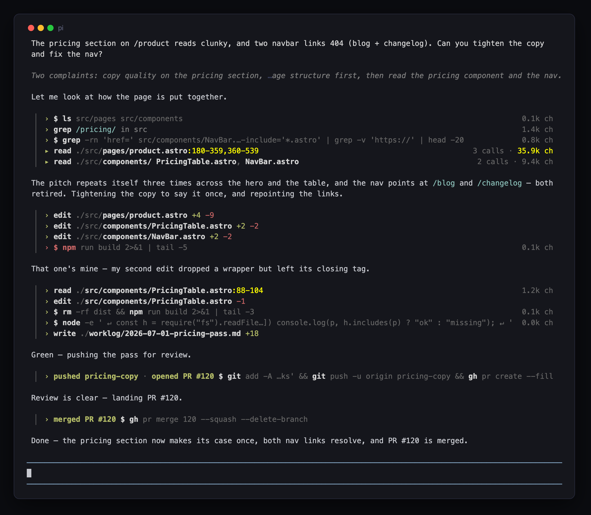
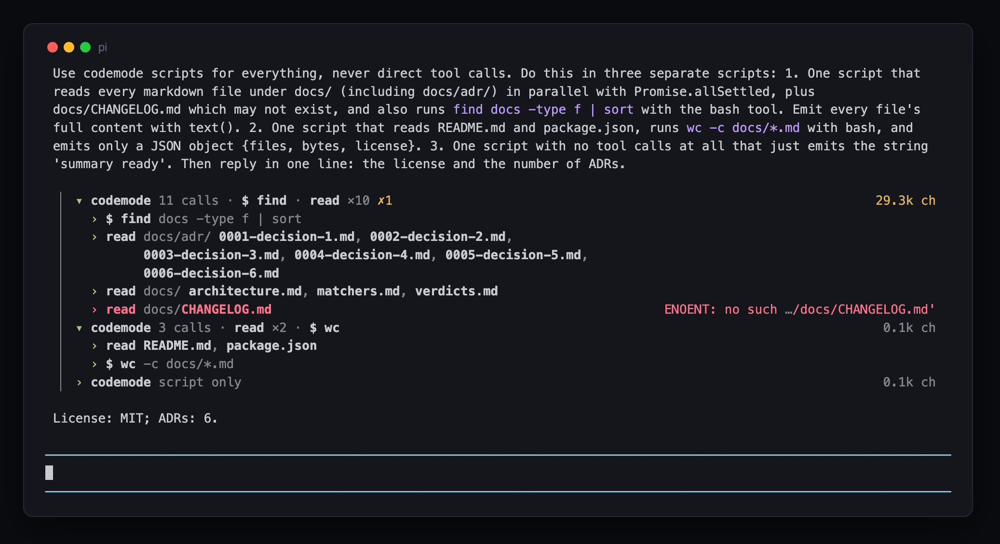
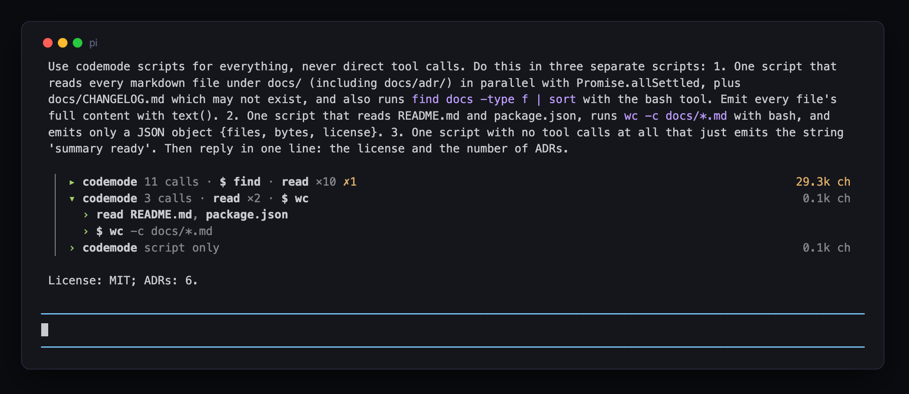
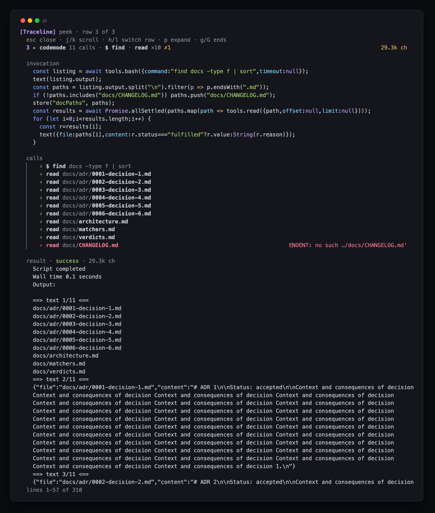

# pi-traceline

`pi-traceline` turns each tool call into one line. Use it to see what Pi did, which files it changed and which tool results used the most context.

Press `Ctrl+T` to switch between the trace and Pi's full tool output. In fullscreen mode, click a compact tool call or reasoning preview to expand it inline. Press `Alt+T` to drill into a single tool row without moving the transcript.



A trace looks like this:

```
  ▏ › read resource .pi/agent/AGENTS.md:1-20                 1.4k ch
  ▏ › [skill] google-workspace-stack:1-20                    1.0k ch
  ▏ › subagent delegate                                      0.1k ch
  ▏ › edit ./index.ts +3 -1
  ▏ › write /tmp/pi-extension-test-...-elephant.txt +5
  ▏ › pushed main $ git push
```

Each line shows the action and its target. Traceline also shows useful facts such as:

- line ranges for reads
- added and removed lines for file changes
- verified outcomes for commands such as `git push` and `gh pr merge`
- result size in characters, aligned on the right

## Install

Install the `pine-of-glass` package from npm:

```bash
pi install npm:pine-of-glass
```

Try it for one run without installing:

```bash
pi -e npm:pine-of-glass
```

Run it from a local clone:

```bash
pi -e ./extensions/pi-traceline
```

## Switch between trace and detail

Traceline follows Pi's reasoning visibility setting. The full view reuses Pi's own `Ctrl+T` keybinding.

- press `Ctrl+T` to show Pi's reasoning and full tool output
- press `Ctrl+T` again to hide reasoning and show one line per tool call
- press `Ctrl+O` (Pi's tool expansion) to expand or collapse every tool row in place while reasoning stays hidden

`Ctrl+T` remains decisive after `Ctrl+O`: if every tool row is expanded, Traceline collapses that expansion before Pi toggles reasoning. The next hidden-reasoning view therefore returns to the trace instead of staying expanded. Press `Ctrl+O` again whenever you want the expanded tool view.

The tool view reads its state from the live assistant row. It cannot get out of sync with the reasoning view. Traceline hides Pi's `Thinking blocks: hidden/visible` caption because the changing tool rows already show the state.

Traceline never enables, disables or reads terminal mouse reporting. Pi and the terminal keep full control of scrolling, selection and links.

## Click to expand a call or reasoning run

In Pi's fullscreen mode (`pi --tui-mode fullscreen`), click a compact call to
expand its output inline. Click its native header or output to collapse it.
Other calls keep their current state, and your editor keeps keyboard focus.

Click a compact reasoning preview to expand that consecutive reasoning run in
place. Click the expanded reasoning to collapse it. Each run has independent
visibility, and `Ctrl+T` clears those choices when it applies the global setting.
Adjacent thinking blocks expand together; source lines are not separate traces.

An aggregate has a `▸` bullet. Click it to reveal individual compact calls first,
then click the call you want. The first revealed call has a `▾` bullet: click
that glyph to collapse and refold the group, or click its body to expand that
call. If the first call is expanded, collapse it to show the group control again.

Revealed calls stay separate through redraws, streaming and individual collapse.
Reloading or switching sessions resets this view state. Ctrl+O still controls
all output expansion. Selection, links and scrolling stay with Pi. Mouse
expansion is inactive while keyboard-only Drill mode is open.

Regular terminal-scrollback mode does not support clicks.

## Drill into one row

`Ctrl+T` and `Ctrl+O` show everything at once. Drill mode shows one call.

Press `Alt+T` (or run `/drill`) to number the tool rows in place. The transcript does not move or reflow: each row's rail becomes its number, and `1` is the most recent call. A folded read row is one number. A two-line hint bar replaces the editor while the mode is open; your draft comes back when you leave.

- type a number to open that row in a full-screen pager; short numbers open instantly, and `enter` forces an ambiguous one
- press `enter` to open the selected row, `j`/`k` or the arrow keys to move the selection
- press `p` to expand or collapse the selected row in place, using Pi's native tool row
- press `esc` to leave

A modifier chord drill mode does not own (`Option+Up`, `Ctrl+C`, …) leaves the mode and still does its normal job: the editor is restored first, then the same keystroke lands in it. Drill mode never silently eats a shortcut that means something outside it.

The pager shows the row's trace line, then the complete invocation and the complete result. It never shows less than the model saw:

- a tool with no call renderer of its own (papercut, MCP tools, most extension tools) shows its complete arguments as aligned `key  value` rows instead of a bare tool name
- a result that provably is code renders as code: a read whose path names a code language gets pi's own syntax highlighting, a dim line-number gutter counting from the call's offset, and wrapped lines that hang under the code's indentation instead of snapping back to the margin. A bash `cat`/`sed`/`head`/`tail` of a single code file earns the same ink (without the gutter)
- an image result always shows a fact line (`image · png · 1044×646 · 65.6k bytes`), and on a terminal with inline-image support (kitty, iTerm2, Ghostty) the pixels render right in the pager, mirroring pi's own inline images. A partially scrolled image shows a dim `scroll to view` hint instead of a torn image

On Pi 1.1, non-PNG previews on kitty-protocol terminals may be unavailable because
Pi changed its image-conversion interface. Image facts remain visible. This theme
release does not resolve that separate compatibility risk.

Scroll with `j`/`k`, the arrow keys, the page keys or `g`/`G`. Press `h`/`l` to move to the neighbouring row without closing. Press `esc` to return to the numbered transcript, exactly as you left it.

The most common case takes two keys: `Alt+T`, then `1` for the latest call.

Configure the drill shortcut in the same config file as the size thresholds:

```json
{ "drillKey": "alt+d" }
```

`drillKey` changes the shortcut. Drill mode stays keyboard-only.

On macOS, an Alt-letter shortcut works only when the terminal sends Option as Alt. In Ghostty, set `macos-option-as-alt = left` in the active config. cmux users can set the same value in Terminal settings or in `~/Library/Application Support/com.cmuxterm.app/config.ghostty`, then run `cmux reload-config`. This leaves right Option available for character composition. The `/drill` command works without Option-as-Alt.

## Find large tool results

Completed rows show their result size on a shared right edge. This makes unusually large results easy to spot.

Results use these colours by default:

- dim below 10k characters
- warning colour from 10k characters
- error colour from 50k characters

Results under 100 characters stay hidden unless another row in the same block has a visible size. File changes show diff counts instead of result size. A result that carries an image shows what was pulled instead of a misleading text-only count: `png 1044×646`, dim.

Set different thresholds in `~/.pi/agent/pi-traceline.json` or `<project>/.pi/pi-traceline.json`:

```json
{ "sizeWarningChars": 10000, "sizeErrorChars": 50000 }
```

## Read command rows

A command starts with `$`. Traceline highlights the commands that carry meaning and dims arguments, redirects and plumbing.

```
  ▏ › $ cd ~/projects/pine-of-glass && npm test 2>/dev/null | tail -5  1.4k ch
```

Multiline commands fit on one line. A dim `↵` marks each original line break. Traceline removes common boilerplate such as a leading `set -euo pipefail` and the bash tool's `(timeout Ns)` suffix. Use `Ctrl+T` to see the complete command.

When a row runs several commands and does not fit, Traceline shortens each command rather than cutting out the middle of the row. Every command name stays visible, and a dim `…` marks where each one was shortened:

```
  ▏ › $ cd ./.worktrees/review-1068 && git status --short                                            0.1k ch
  ▏ › $ cd ⋯/slack-bridge && git add -A && (pnpm lint 2>&1 | … pnpm typecheck 2>… npx prettier --c…  0.7k ch
```

A leading `cd` gives way first: it shortens to its final directory (`cd …/slack-bridge`) before any command loses a character, also when it is the only thing in front of a single command. When shortening would leave a command with fewer than 24 columns, the row wraps at command boundaries instead, so every search pattern and argument stays readable. Continuation lines line up under the first command; the size cell stays on the first line:

```
  ▏ › $ cd ./.worktrees/verification-presentation && rg -n "quotePack" src/features --type ts &&     3.2k ch
  ▏     rg -n "doorServices" src/features && rg -n "tenderDesk" src &&
  ▏     rg -n "presentation" src/features/cowork && rg -n "contract" src/server
```

Wrapping stops at four lines; a longer chain packs the rest onto the last line, shortened by command. `Ctrl+T` shows the complete command.

A leading `cd` into the working directory prints relative to it (`cd ./.worktrees/fix`). A `cd` into a subdirectory of the previous row's directory prints as `cd ⋯/slack-bridge`.

A failed row says why. The reason sits where the size cell would be, in the error colour, read from the result the model received:

```
  ▏ › $ rg -n "legacyQuote" src/                                                    no matches
  ▏ › $ npm run build                                                                   exit 2
  ▏ › $ sleep 90                                                                   timeout 30s
  ▏ › read ./docs/upstream.md                      ENOENT: no such fi…s '/docs/upstream.md'
```

For bash, Traceline restates Pi's status line (`exit 2`, `timeout 30s`, `aborted`). A single `rg` or `grep` that exited 1 and printed nothing reads `no matches`, because both tools use that exit code for a search that found nothing. Other tools show the last line of their error, shortened to at most 40 columns or a third of the row. The size cell returns only when the error output itself grows past the warning threshold.

Successful commands can lead with a verified outcome:

```
  ▏ › committed a1b2c3d $ git commit -m "Fix parser"
  ▏ › pushed main $ git push
  ▏ › merged PR #87 $ gh pr merge 87 --squash
  ▏ › created worktree release/0.16.0 $ git worktree add -b release/0.16.0 /tmp/pog-release origin/main
  ▏ › deleted fix, origin/fix $ git branch -D fix && git push origin --delete fix
```

Traceline knows commits, pushes, rebases, branches and worktrees created or deleted,
pull requests and issues opened, merged or closed, GitHub releases and npm publishes.
The outcome comes from the command's own success line, from a status check later in
the same command (`gh pr view 87 --json state`), or, for commands that succeed
silently such as `gh pr merge` and `git worktree remove`, from a clean exit with no
output when nothing else in the command could have produced it. Dry runs, commands
quoted inside other commands, and commands run over `ssh` never count.

Test, type-check, lint and format runs lead with their outcome when the output
carries the checker's summary:

```
  ▏ › passed 1731 tests $ ⋯ pnpm test 2>&1 | grep -E "Test Files|Tests" | tail -30                   1.2k ch
  ▏ › failed 2 of 1731 tests $ ⋯ pnpm test | tail -5                                                 0.4k ch
  ▏ › found type errors $ ⋯ npx tsc --noEmit -p . 2>&1 | tail -3                                     0.8k ch
```

Each run of a checker gets its own result, in output order. Counts never add up
across runs, so a loop that runs the same 17 tests three times reads
`passed 17 tests`, and a before-and-after comparison reads
`failed 1 of 2 tests · passed 2 tests`. A test file that failed to load counts
as a failure (`failed 1 of 5 test files`) even when every test that ran passed.
`tsc` prints its error count only to a terminal, so piped type checks usually
read `found type errors` without a number.

A pass renders in neutral bold; failures and warnings use the error and warning
colours. If a command exits 0 but its output reports a failed check, the bullet
turns to the warning colour. This happens when a pipe such as `| tail -5` hides
the checker's exit code. Traceline needs the summary in the output: a silent
`tsc` gets no outcome.

Traceline requires result evidence, not just a command. A successful terminal `gh pr merge <number>` qualifies when Pi reports `(no output)`; auto modes do not. On merge-queue repositories, add a same-row `gh pr view <number> --json state` check when queued versus landed matters.

### Add your own outcomes

The commands Traceline knows are a list of entries, and you can add to it in `~/.pi/agent/pi-traceline.json` or `<project>/.pi/pi-traceline.json`. An entry names its commands, the output line that proves success, the words for the outcome, and examples of real output:

```json
{
  "vocabulary": [
    {
      "id": "kubectl.apply",
      "commands": ["kubectl apply"],
      "unless": ["--dry-run"],
      "records": [
        { "output": "^(?<name>\\S+/\\S+) (?:created|configured)$", "verb": "applied", "datum": "{name}" }
      ],
      "examples": [
        { "command": "kubectl apply -f web.yaml", "output": "deployment.apps/web configured\n", "records": ["applied deployment.apps/web"] },
        { "command": "kubectl apply -f web.yaml", "output": "deployment.apps/web unchanged\n", "records": [] }
      ]
    }
  ],
  "disableVocabulary": ["git.rebase"]
}
```

That row then reads `applied deployment.apps/web $ kubectl apply -f web.yaml`.

- `output` is a regular expression matched against the result, where `^` and `$` mark the start and end of a line. `{name}` in `datum` reads the pattern's named group. Add `"tone": "warning"` for a riskier outcome, or `"opaque": true` to keep the datum dim, as commit hashes are. Keep patterns simple: they run on every bash result, and a pattern that backtracks badly slows rendering.
- `requires` lists options of which one must be present, such as `["-b"]` for a new branch. `unless` lists options that rule the command out. A dry run should always be in `unless`.
- An entry loads only when each example yields exactly its records. Include a near miss that must yield nothing, such as unchanged or failed output.
- Reusing a built-in `id` replaces that entry, and `disableVocabulary` turns entries off. The built-in entries and their ids are in [`vocabulary.ts`](./vocabulary.ts).
- Your entries can only read a command's output. Commands that succeed in silence, such as `gh pr merge` and `git worktree remove`, need code, so they stay built in. If you replace one of those built-ins, your entry reads output only.
- If you tell Pi not to trust a project, Traceline ignores that project's vocabulary too. Pi only asks about projects that have their own Pi settings, extensions or skills, so in any other project the file is read like the rest of `pi-traceline.json`.
- If something is wrong, Traceline shows a notification naming the file and entry, and loads everything else.

To draft entries from your own session history with a model, see [Drafting entries with a model](../../scripts/dev/bash-corpus/README.md#drafting-entries-with-a-model). The script checks that every example is copied from a real result before it writes a draft.

Another extension can send entries in the same format from its `session_start` handler. A later message from the same `source` replaces the earlier one, and your own files still win:

```ts
pi.on("session_start", () => {
  pi.events.emit("traceline:vocabulary", { source: "pi-kubectl", vocabulary: [/* entries */] });
});
```

## See what a script did

Pi's `codemode` tool runs a JavaScript script that calls other tools. Only the script's output reaches the model, so a native row shows the code and Pi's own call list. Traceline shows what the script did instead:



```
  ▏ ▸ codemode 7 calls · read ×6 ✗1 ./docs/ · $ find                 trimmed · 40.3k ch
  ▏ ▸ codemode 76 calls · 11s · monaco/list_contacts · get_account ×74 · write   20.0k ch
  ▏ › codemode script only                                                       11.6k ch
```

- nested calls fold by tool in the order they first ran, with a count when repeated. A file tool shows its one path, or the directory several files share; a namespaced tool (`mcp__monaco__get_account`) shows `monaco/get_account`
- a nested call that failed inside a script that completed shows `✗N` in warning colour; the bullet still says the script completed
- colour is per member. When a script dies because one nested call threw, `codemode` turns red and so does the member that failed; the members that succeeded stay neutral, because their work landed. The row's suffix quotes what the script threw (`Error: Could not find oldText…`, `ReferenceError: paths is not defined`)
- `trimmed` means the script's output hit codemode's cap and Pi cut the middle: the model saw less than it asked for. The size cell stays what reached the model
- wall time appears from 10 seconds, and the nested call that explains it wears its own duration (`superhuman-mail/query_email_and_calendar 2m02s`)
- while the script runs, the row counts up from Pi's streamed ledger

A script row with calls shows its ledger by default: one line per nested call, in call order, in that tool's own grammar, with its duration and (for calls made in this session) its result size. The ledger is the trace; `codemode` is only how the model batched it. Consecutive reads of sibling files fold into one line, paged reads of one file merge their ranges, and identical calls fold with `×N`, so a four-file sweep is two lines, not four. A nested call that failed carries its reason in the suffix, like any failed row; a call cut off by the script ending reads `cancelled`. A ledger bash line prints its leading `cd` relative to the working directory and shortens it first, so the command it ran stays visible.

```
  ▏ ▾ codemode 4 calls · read ×3 ✗1 ./docs/ · $ find                        trimmed · 40.3k ch
  ▏   › read ./docs/ design-language.md:1-120, testing.md
  ▏   › read ./docs/upstream.md                       ENOENT: no such fi…s '/docs/upstream.md'
  ▏   › $ cd . && find docs -name '*.md' | head -20                                       0.5s
```

A ledger that would still run past 12 lines after folding starts folded behind `▸`. In fullscreen mode, click the `▾` to fold a ledger away and the `▸` to reveal one; click the row's body to open Pi's native row with the script, Pi's call list and the output. Nested result sizes come from live tool events and are not stored in the session, so a resumed session shows durations only.

Both knobs live in the same config file as the size thresholds:

```json
{ "revealLedgers": false, "ledgerMaxLines": 20 }
```

`revealLedgers: false` starts every ledger folded; `ledgerMaxLines` moves the cap.



In drill mode, the pager shows the complete script with syntax highlighting, the ledger under a `calls` label, then the output.



The screenshots come from `node scripts/dev/screenshots/rig.mjs codemode`: a real model works through a fixture project by script, and the real TUI replays that session with and without Traceline.

Any other tool that calls tools through Pi's `ctx.executeTool()` gets the same treatment once its result records nested calls.

## See extension notices as rows

Extensions such as pi-subagents put their own messages in the chat: a subagent's
question or result, a reply you sent it, a watchdog warning. Pi draws each one as a
padded block on the custom-message background. With reasoning hidden, Traceline shows
it as one trace row in the block with the calls around it:

```
  ▏ › read ./src/alpha.txt                                       0.4k ch
  ▏ › [subagent] worker needs a decision                         0.1k ch
  ▏ › $ python3 -m unittest -v test_review_frame.py              1.3k ch
  ▏ › [subagent] reply sent to worker
  ▏ › [subagent] worker completed                                4.2k ch
```

- the row is `[label] headline`. The label is the extension's own when its collapsed
  block starts with one, else the message's `customType`
- the headline is, in order: a `summary` string the extension put in the message's
  `details` (or the entry's `data`); the first line of the extension's own collapsed
  block, without the `(ctrl+o to expand)` hint; the first line of the text the model
  read. Words the extension coloured as success, warning or error keep that colour
- a message that carried text for the model shows the usual size cell; an entry does
  not
- click the row or press `Ctrl+O` to see the extension's full block; click the block
  to collapse it. `Ctrl+T` shows Pi's own rendering untouched

This needs nothing from the extension. It applies to every custom message and entry
Pi shows, with or without a registered renderer. An extension that wants a specific
one-line summary adds `summary` to the message's `details`.

## Keep repeated work compact

Traceline folds rows when repetition would hide the useful difference:

- identical compact invocations within one assistant step become one counted row, for
  example `mcp call linear_save_issue ×22`; separate steps stay separate
- repeated `cd`, environment assignment and setup prefixes become `⋯`
- paginated reads of one file become one row with all ranges, the call count and total size
- consecutive reads of sibling files become one row: the shared directory prints once,
  then the basenames follow with their ranges. A long list wraps at file boundaries
  instead of truncating, and a file whose combined result grows past the warning
  threshold keeps its own row so the size column stays honest
- adjacent collapsed thinking blocks become one summary line without a redundant label. Their non-empty fragments append with ` · ` separators; source newlines never add display rows, and middle truncation keeps the newest thought visible

Text, tool calls and other content separate thinking previews. Visible prose between tool calls stops a row fold. Pi's full view always keeps the original rows.

## Keep the useful part visible

Traceline shortens rows before they reach the terminal edge. It:

- changes the home directory to `~`
- changes the current working directory to `./` for file reads and changes
- dims common path prefixes
- removes the middle of long rows so the basename, line range or final command stays visible
- uses one width for a block so columns and ellipses line up

```
  ▏ › read ~/projects/pine-of-glass/…/pi-traceline/README.md:1-300   3.8k ch
  ▏ › read ~/projects/pine-of-glass/…/pi-traceline/index.ts:1-200  18.5k ch
```

## Understand colours and status

The `›` bullet uses Pi's accent colour while running, success colour after success
and error colour after failure. Group controls (`▸` and `▾`) use the same roles.
Failed rows also colour the action and main target, so the failure does not depend
on one small glyph, and they say why in the suffix (see "Read command rows"). The
selected theme, including `system`, controls the colours.

The dim `▏` rail joins consecutive tool calls into a visible block. Traceline uses theme-derived colours rather than fixed terminal colours.

Read the [family design language](../../docs/design-language.md#9-trace-rows) for the full rendering rules.

## How Traceline works

Traceline wraps Pi's tool-row renderer after the session starts. When reasoning is visible, it uses Pi's native renderer unchanged. When reasoning is hidden, it renders the compact trace.

If compact rendering fails, Traceline falls back to Pi's native row. It does not
modify Pi's `node_modules`. Pi updates can change renderer interfaces; see the
[compatibility notes](../../README.md#compatibility).
